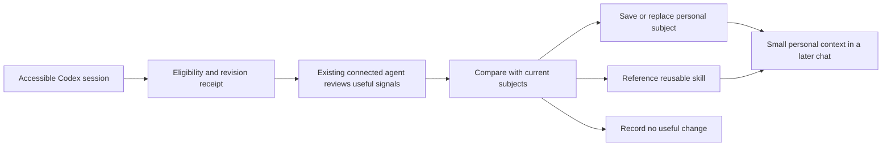

# Personal working memory and Codex session coverage

Research date: 2026-10-21, Asia/Taipei. P01 research and documentation; recommendations below are not implemented product behavior.

## Finding

**NeuralVault should learn how its owner works across sessions, while saving only information that changes a future decision. It cannot currently substantiate that every eligible Codex session has been reviewed.**

The existing K01 policy is a useful foundation: scoped subjects, explicit owner statements, immutable corrections, candidate separation, evidence and a valid no-save outcome. The main gaps are an auditable capture outcome for each eligible session, a richer personal working profile, and a separate way to discover reusable skills. Bulk conversation storage would not solve those gaps.

Interpretation of the owner's current request: broad opportunities to learn across accessible Codex sessions, selective durable personal knowledge, and useful procedures. Comprehensive project histories are not the objective. This interpretation does not authorize deleting existing project records, importing every transcript, installing hooks, changing clients or launching background AI.

## What was inspected

- Current project/vault instructions; progress, tasks, architecture, latest session-log entry and amended implementation handoff.
- Capture policy, installed global ATLAS instruction block, MCP registration, redacted memory configuration and hook destinations.
- Local knowledge contracts, context selection, replacement handling, conversation import and current knowledge-view filtering.
- All 111 JSONL files present under this PC's default Codex sessions directory at the audit snapshot. Processing parsed session metadata and ATLAS-related tool-call records; no conversations were copied into the vault or distilled in bulk.
- Current visible Markdown inventory, excluding `.atlas/` and `.obsidian/`; local skill-directory file counts.
- Official documentation for Codex, Claude Code, Cursor, Windsurf/Cascade, Mem0 and LangGraph; the LongMemEval paper, v2 dated 2025-03-04. These establish documented designs, not independent performance verification of the products.

The historical memory registry helped locate relevant prior implementation evidence. Current claims below were checked against files/tools rather than accepted from old test totals.

## Current coverage: encouraging adoption, incomplete assurance

Snapshot: 2026-10-21 22:37:51 Asia/Taipei, **before this research session saved the clarified preference**. Evidence: `.artifacts/personal-memory-research-2026-10-21/session-indicators.json` and its audit script.

| Observation | Result | What it establishes |
| --- | --- | --- |
| Available local session files | 111, about 797 MB; start dates October 12–21 | A local inventory, not all account/cloud history |
| Main chats versus subagent records | 33 main; 78 with subagent-source metadata | Raw file count is not a count of independent owner chats |
| Main chats with an ATLAS call indicator | 25 of 33 | Evidence of attempts to use the integration |
| Main chats starting October 17 or later, Taipei | 24; 23 have an ATLAS call indicator | Strong recent adoption of the instruction workflow |
| Main chats with a checkpoint-save indicator | 8 of 33 | Some saves were attempted; a low count is not inherently a defect |
| Initial visible vault Markdown | 50 files: 15 Project.md, 19 Knowledge files, 11 legacy Notes, 5 other files | Knowledge and historical activity already coexist |
| Initial owner Knowledge records | 4, all concerning the ATLAS workflow | Personal context is narrow in this particular collection |
| Initial project Knowledge records | 15 physical files | Includes versions; physical file count is not active-concept count |
| Native Codex memory configuration | Feature, generation and use explicitly enabled | Separate native memory functionality is configured |
| Installed ATLAS workflow | Global instruction block and MCP entry present; start/context/save worked in this chat | This client can access the local vault now |
| Existing user hook destinations | Five lifecycle hooks reference a DevDock activity handler | They are not an explicit ATLAS capture-receipt integration |

The audit counts exact direct tool names and recognizable wrapped calls/launcher commands. They are **diagnostic attempt indicators**, not validated successes or semantic review. Wrappers can contain diagnostic commands; forks can carry history; direct Markdown saves are not counted. Active chats, subagents, pre-installation chats and valid no-save outcomes must not be labeled failures. The 78 subagent records are not 78 missing personal-memory reviews; the parent should normally own consolidation.

No eligible-session denominator, processed cursor or explicit examined/no-save receipt was found in the inspected capture contracts and workflow. Therefore neither “all sessions are covered” nor “every file without a save was missed” is justified. Other machines, cloud-only chats, deleted/inaccessible history and alternative Codex homes remain outside this inventory.

## How comparable systems handle the problem

### Codex: native selective memory is a separate store

Codex documents local memory generated from eligible prior chats, with delayed background processing and controls for contributing/using memory. Its generated files live under Codex home, separately from this vault. Required guidance belongs in instruction files. [Official memory documentation](https://learn.chatgpt.com/docs/customization/memories).

Eligibility is bounded: the configuration reference documents idle, age, per-pass and quota thresholds. It also documents a switch that excludes tool-assisted chats, currently defaulting to false. These are documented defaults, not a resolved settings audit for every chat. Native memory generation therefore cannot serve as a guaranteed receipt that ATLAS reviewed all sessions. [Configuration reference](https://learn.chatgpt.com/docs/config-file/config-reference).

**Apply here:** native memories can provide leads for selective backfill, but their generated conclusions must be checked against owner statements before promotion. Keep one authoritative curated owner collection; avoid two independently rewritten profiles.

### Claude Code: corrections, typed notes and a small index

Claude Code separates authored instructions from auto memory. Its documented note types include user, feedback, project and reference. It saves information useful in later conversations rather than requiring a note every session. Auto memory is repository-scoped, shared across worktrees, and machine-local. [Claude Code memory](https://code.claude.com/docs/en/memory).

Its startup index is bounded; topic files load on demand. The design also avoids saving information already available from code or instruction files. **Apply here:** favor explicit corrections and working preferences, keep the owner index short, and link to detailed subjects. Repository memory alone is insufficient for a personal profile spanning unrelated projects. [Index and auto-memory behavior](https://code.claude.com/docs/en/memory#auto-memory).

### Cursor: global preferences and conditional project rules

Cursor documents global User Rules separately from scoped Project Rules and supports always-applied, relevance-selected, file-matched and manual activation. Its guidance favors focused rules, canonical references and additions driven by recurring mistakes rather than copying entire guides. [Cursor rules](https://cursor.com/docs/rules).

**Apply here:** a small baseline can explain how to collaborate with the owner; task-specific preferences and procedures should load when relevant. This is evidence about Cursor's rule design, not a claim that it automatically learns every personal preference from every session.

### Windsurf/Cascade: workspace memories are not a global owner model

The Windsurf documentation URL currently redirects to Devin Desktop documentation. It describes Cascade memories as local, workspace-associated and retrieved when relevant; durable guidance is better represented as rules or skills. The fetched page explicitly limits those memories to the legacy Cascade agent and says the newer default local agent does not persist them. [Current redirected documentation](https://docs.devin.ai/desktop/cascade/memories).

**Apply here:** record the actual client/agent capability instead of assuming a product-wide memory guarantee. Workspace memories do not automatically provide an owner profile across workspaces, and migrated clients can change behavior.

### Mem0: extract, deduplicate, scope, retrieve and correct

Mem0 documents extracting memories rather than storing verbatim input by default, looking up related memories before adding facts, filtering by identity/session metadata, and retrieving only relevant results. Current documentation describes automatic extraction as additive and calls for explicit update/delete operations for corrections. [How Mem0 works](https://docs.mem0.ai/core-concepts/how-it-works).

**Apply here:** reuse its separation between messages and reusable facts, but keep ATLAS's explicit replacement chain. Do not assume inserting a newer conflicting fact resolves the older one. Its model/embedding/database infrastructure is not needed for this local workflow and would conflict with the current no-separate-AI-service design.

### LangGraph: conversation state, personal facts and procedures differ

LangGraph distinguishes thread history from cross-thread memory, and facts, experiences and procedures. It describes both a profile and a collection of individual memories, including their different update/retrieval risks. It also distinguishes writes during a conversation from later background consolidation. [Memory overview](https://docs.langchain.com/oss/python/concepts/memory).

**Apply here:** use an owner index backed by individual versioned subjects; keep skill procedures separate from episodic logs. Existing connected agents can capture during work. Deferred deterministic queues may track unfinished review, but cannot perform inference themselves. A fully autonomous background extraction service would require a separately authorized design.

### Research evidence: retrieval and correct use matter as much as storage

LongMemEval tests extraction, reasoning across sessions, time, knowledge changes and abstention. It finds that granular retrieval and temporal metadata matter; compressing everything into isolated facts can also lose context. **Implication for this vault:** preserve conditions, exceptions and a source reference, and test whether a later chat uses the right current knowledge. A count of stored notes cannot demonstrate personalization quality. These are design implications from a benchmark, not measured ATLAS performance. [LongMemEval v2, methods/results](https://arxiv.org/html/2410.10813v2).

## Recommended personal-memory structure

Retain local Markdown as truth and preserve current records. Add a personal-first presentation and retrieval route; do not flatten all project knowledge into owner scope.

| Collection | Content | Default behavior |
| --- | --- | --- |
| Owner index | Brief map of explicit collaboration preferences, constraints and subject links | Small baseline for personal context |
| Owner knowledge | One versioned subject per preference/constraint: claim, applicability, exceptions, source | Relevant active subjects only |
| Skill catalog | Purpose, trigger, canonical installed path, provenance/version and availability | List metadata first; open procedure when needed |
| Candidate review | Possible patterns with evidence and uncertainty | Excluded from active owner context |
| Project knowledge | Necessary scoped facts/decisions | Only when the task needs that project |
| Coverage receipts | Session/revision identity, reviewed outcome and linked records | Operational audit; excluded from personal recall and graph clutter |

The current owner knowledge contract intentionally accepts only explicit owner preferences/constraints. Inferred patterns cannot simply be inserted there as active lessons. Keep any future owner-pattern candidate lane separately modeled until a specific design is approved. Existing project/domain candidate mechanisms should be reused where appropriate without changing their meaning.

Current context selection accepts a repository and mixes owner knowledge with that project's knowledge. Its query path can omit an owner subject when lexical terms do not match; its empty-query path interleaves owner/project records. A future owner-only route should work for projectless chats, reserve a small baseline, and load relevant topic detail without pulling in arbitrary project records.

### Decide what deserves saving

Ask: **What future decision will change because this is available?** If no concrete answer exists, skip it.

| Signal or example | Handling |
| --- | --- |
| Explicit, broadly applicable working preference | Save/reuse one owner subject with conditions |
| Owner correction that changes collaboration behavior | Amend the matching subject; preserve its earlier version |
| Verified repeatable procedure with useful inputs, steps and checks | Reference an existing skill; propose a new skill only when it adds something |
| Same correction recurring across independent sessions | Strengthen evidence or create a candidate; repetition alone does not establish universal intent |
| One project's visual or technology choice | Keep scoped or skip; do not generalize it |
| Status reports, build totals, copied tool output or routine fixes | Leave in project/session history |
| Generic advice the model already knows | Skip |
| Assistant-written guesses about the owner | Exclude from active owner knowledge |
| Mood inferred from a single message or unrelated sensitive details | Skip |
| Unchanged information | Reuse existing subject; optionally add compact evidence instead of another near-duplicate |

Keep rich enough context to apply a preference correctly. “Likes quality” says little. A useful subject names the decision, the conditions under which it applies, and an exception supported by the owner. Examples in this section are classification rules, not new claims about the owner's personality.

### Treat skills as procedures, not transcript fragments

The audit found 40 SKILL.md files under the user's `.agents/skills` and 74 under `.codex/skills`, including system material. These are physical file counts, not 114 unique or important skills; plugin caches and project-specific locations were not exhaustively inventoried. No skill catalog was found in the visible vault inventory.

Codex documents metadata-first skill discovery and loading full instructions only when used. It also notes duplicate skill names are not merged. Follow that pattern: catalog canonical locations, deduplicate aliases/versions and verify availability. Do not copy installed/plugin instructions into owner memories or treat having a skill installed as evidence that the owner prefers it. [Official skill documentation](https://learn.chatgpt.com/docs/build-skills).

Important custom skills should be included in an intentional backup of their source directories, or copied/versioned as a managed source artifact with license/provenance where appropriate. A pointer alone is not a backup. Avoid vendoring every third-party plugin or continuously rewriting its managed files. New instructions/code are an executable behavior change, so a discovered procedure should first be a reviewable skill candidate unless already authorized.

## Make coverage provable without saving noise

For each eligible main-session revision, retain a small operational receipt with session identity, host, last reviewed turn/cursor or digest, policy version, outcome and any resulting subject IDs. Suggested outcomes: `pending`, `reviewed_saved`, `reviewed_no_change`, `reviewed_no_value`, `excluded`, `failed`, `source_unavailable`. An attempted tool call alone must not advance a cursor to reviewed.

Eligibility must respect current privacy/read-only instructions, exclusions, available host access and consent controls. Subagent work should normally be consolidated into its main chat. Mark missing sources unavailable instead of manufacturing a summary. Coverage means reviewed eligible revisions divided by identified eligible revisions; show pending, excluded and unavailable counts separately, with an as-of time and host scope. A session's later turns can create a new review revision.

Codex now documents lifecycle hooks including start, stop, compaction, interruption and end. Hooks have a trust review, and transcript format is explicitly unstable. SessionEnd is not triggered by simply switching chats and has a short execution timeout. [Official hooks documentation](https://learn.chatgpt.com/docs/hooks).

Consequently, a future hook should perform short deterministic work: identify or queue a changed session, record delivery status, and load a bounded reminder/context where supported. Existing connected agents perform the judgment and save through ATLAS at meaningful work checkpoints. Do not put model inference in an end-hook shell command or depend only on normal shutdown. Verify support and hook trust on the installed desktop/CLI/IDE surfaces before claiming coverage; do not bypass the trust mechanism.

A local reconciler can detect missing/revised files and queue review, including after a crash. It cannot claim it understood their content. Pending review remains pending until a connected agent actually completes it. Starting a scheduler/service or an AI agent is not part of this research.

## Prioritized next work

| Priority | Change | Acceptance evidence |
| --- | --- | --- |
| P0 | Define personal-first scope and save/skip rules in the product workflow | Personal context contains owner subjects, with optional relevant project detail; routine tasks can produce zero knowledge |
| P0 | Add revision-aware reviewed/no-change/no-value/failed receipts | An identified session has an explainable outcome; a failed save cannot masquerade as reviewed |
| P0 | Verify start/checkpoint/compaction/interruption lifecycle behavior in installed clients | Actual desktop chat, resumed chat and new-chat retrieval; no assumed hook capability |
| P1 | Selective backfill of accessible main chats | Dry-run candidate list with source locators; apply only eligible useful subjects; no raw transcript import |
| P1 | Personal profile and skill-catalog views | Owner-only retrieval works without manufacturing a project; canonical skill opens only when relevant |
| P1 | Correction, deduplication and forgetting controls | Old preference is superseded, conflicts stay visible, dismissed candidates do not return on rescans |
| P1 | Personalization evaluation | Later chats use relevant current preferences and abstain from unsupported claims |
| P2 | Additional machines/cloud clients | Explicitly configured host adapters and separate coverage scope; no claim of account-wide coverage from this PC |

For backfill, use current instructions and the original owner turn where accessible. Native generated memories and old agent reports are leads, not owner confirmation. Start with correction/preference-bearing main sessions rather than ingesting 797 MB wholesale. A deleted source, missing owner turn or ambiguous scope is a reason to defer a claim.

For forgetting, distinguish excluding a subject from default retrieval, rejecting a candidate and erasing sensitive material. Existing append-only history is useful for ordinary corrections but would require a separately designed purge path for actual erasure. A small suppression marker can prevent rescanning from recreating a rejected claim without retaining the rejected text.

### Evaluation that would answer the owner's concern

Use a small reviewed set of real, secret-free examples and held-out future-session prompts. Assess:

- Capture precision: saved subjects are useful, correctly attributed and scoped.
- Missed corrections: important explicit working preferences were not lost.
- Recall and application: a fresh chat retrieves and follows the relevant current subject.
- Update behavior: changed preferences resolve correctly; unresolved conflicts do not silently pick a winner.
- Noise resistance: routine completion logs and one-project choices do not contaminate the personal profile.
- Skill relevance: a matching procedure is available when useful and absent from unrelated context.
- Operational coverage: pending/no-value/failed outcomes are visible without inflating the count of memories.

Set acceptance criteria from the reviewed examples before measuring. No personalization score, accuracy percentage or complete-coverage claim was established by this research.

## Changes and checks in this research session

- Added this report and aggregate local audit artifacts; updated P01 tracking.
- Saved one explicit clarification by replacing the existing `workflow.knowledge-quality` subject with a new linked version, `6ee552ea-3446-40aa-938e-8459a835ccc5`. The original `b8968fe0-064e-47d7-89c2-f73ca8952d2c` remains intact. A separate context call returned the new active version without warnings.
- This produces five physical owner knowledge files but still four active owner concepts. It records the owner's preference; it does not implement a new capture policy, bulk backfill or client integration.
- Research validation passed: `node --check` for the audit script, JSON/inventory calculations, unchanged hashes for all 50 baseline visible Markdown files, exactly one new owner knowledge file, and unchanged source-brief SHA-256 `BC1CB856343D4E9057D8EFCF2ACE85D380A324EB0D2490C078B110BA1BC27B0A`. Evidence is in `.artifacts/personal-memory-research-2026-10-21/validation.json`. No application source, client configuration, hook, startup installation, cloud resource or installed skill changed; no new dependency, model SDK or AI API was added. Application build/tests were not rerun for this research/documentation task.
- The first audit execution failed while deriving a Windows path from a percent-encoded file URL; replacing manual pathname handling with Node's `fileURLToPath` corrected it. The successful inventory reported zero parse errors among the selected metadata/call records. Initial PowerShell `rg` path-glob errors were corrected to directory searches.

The next implementation should prioritize personal working knowledge and observable capture outcomes. More graph nodes, more project notes or more copied conversation text would not by themselves demonstrate that the AI understands the owner better.
